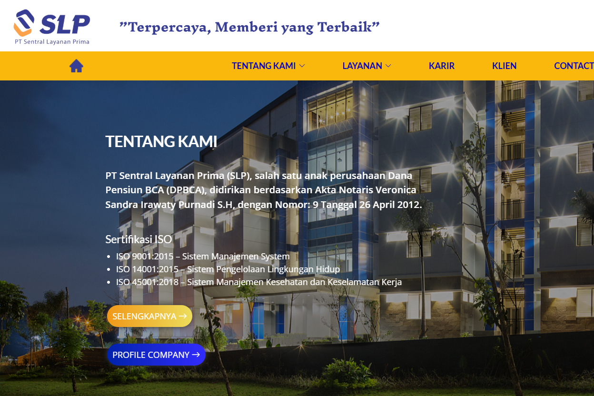

# PT Sentral Layanan Prima

PT Sentral Layanan Prima company website with information about facility management and workforce services.

**Status:** Live · [Visit website](https://pt-slp.co.id/)

## Preview

## Features

- Outsourcing and recruitment services
- Building, dormitory, and parking management
- Training information, company profile, and contact details

## Technology

HTML, CSS, JavaScript, PHP.

## Running Locally

Use an Apache/PHP server, such as XAMPP. Place a copy of the project in the document root and open `index.html` through localhost. Any `.htaccess` rules require an appropriately configured Apache server.

## Contact Form

`forms/contact.php` references the PHP Email Form library from the original template. That library is not included in this copy; form submission requires the library and appropriate server configuration.

## Repository Notes

Installed dependencies, caches, `.env` files, databases, and user uploads are not included. Brand names and third-party assets remain subject to their respective owners' rights. This repository does not grant a license for reuse.
